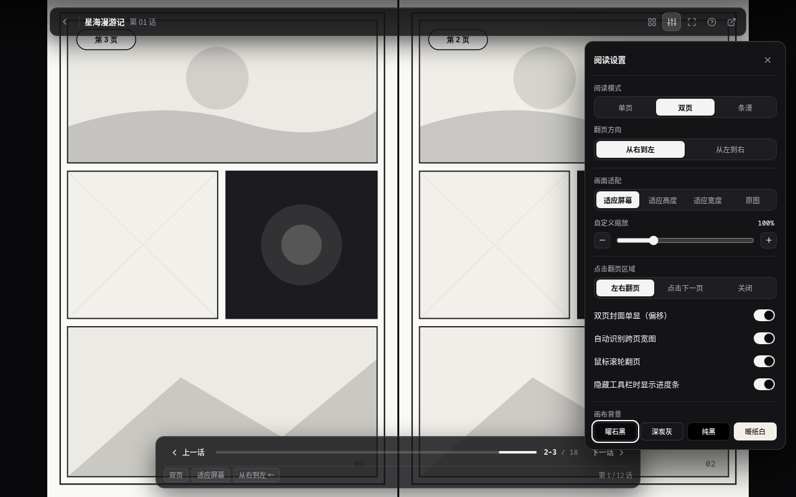
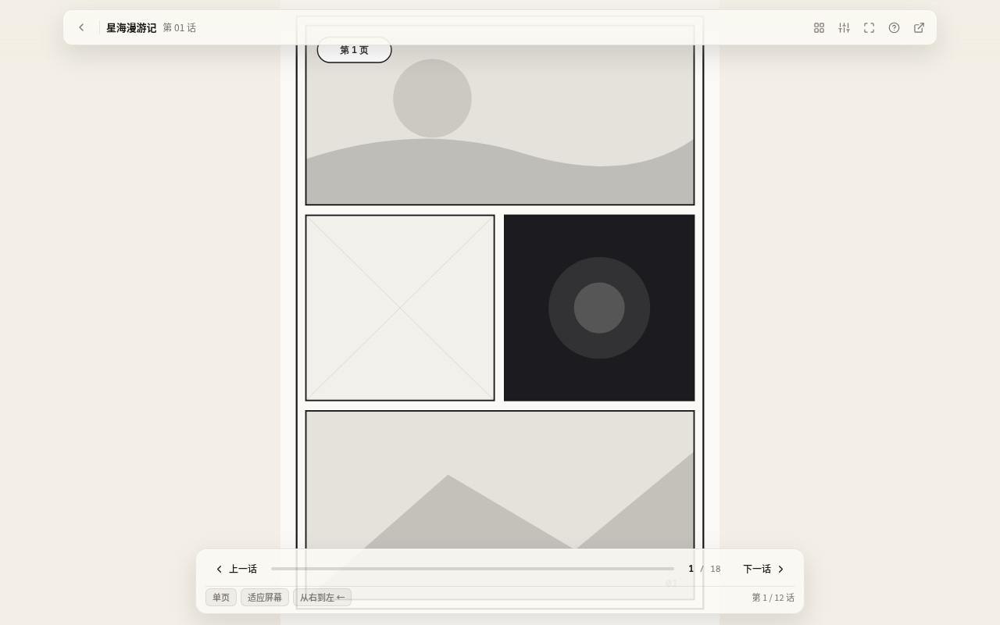
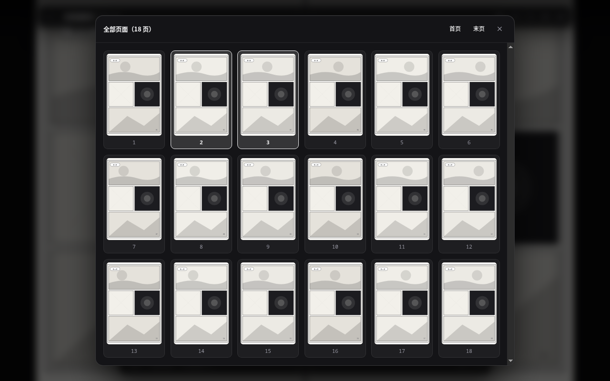

# 网页漫画增强阅读器

桌面级网页漫画阅读器脚本，用来替换漫画网站简陋的原生网页阅读器。目前已支持拷贝漫画及其常见镜像站，后续可扩展适配更多漫画站点。

## 界面预览

### 双页阅读与设置面板（曜石黑）

### 单页阅读（暖纸白主题）

### 页面总览

## 主要功能

- **三种阅读模式**：单页、双页（支持封面单显偏移与跨页宽图自动识别）、条漫（可调页间距）
- **阅读方向**：支持从右到左（日漫默认）与从左到右，联动双页排版、点击区域、进度条与方向键
- **画面适配与缩放**：适应屏幕、适应高度、适应宽度、原图 `1:1`，以及 `50%–250%` 自定义缩放
- **顺手交互**：点击翻页区域、滚轮翻页、悬浮进度条预览、页面总览网格、4 套画布主题（曜石黑 / 深炭灰 / 纯黑 / 暖纸白）
- **进度记忆与逃生舱**：自动记住阅读设置与各章节阅读页码；随时按 `Alt + O` 切回原版页面
- **零外部依赖**：本地解析当前页面的章节数据，不额外请求站内接口

## 安装方式

### 方式一：油猴脚本（推荐）

1. 先安装浏览器脚本管理器：[Violentmonkey（暴力猴）](https://violentmonkey.github.io/) 或 [Tampermonkey（篡改猴）](https://www.tampermonkey.net/)
2. 点击下方链接一键安装（后续支持自动更新）：
   👉 **[点击安装 manga-reader-plus.user.js](https://raw.githubusercontent.com/Roroca-1/manga-reader-plus/main/manga-reader-plus.user.js)**

### 方式二：浏览器扩展（Chromium 内核）

1. 下载本仓库，打开 `chrome://extensions` 并开启「开发者模式」
2. 点击「加载已解压的扩展程序」，选择仓库内的 `extension/` 目录即可

## 常用快捷键

| 按键 | 功能 |
| --- | --- |
| `←` / `→`、`A` / `D`、`Space` | 上一页 / 下一页（遵循当前阅读方向） |
| `[` / `]` | 上一话 / 下一话 |
| `1` / `2` / `3` | 切换 单页 / 双页 / 条漫 |
| `F` / `+` `-` `0` | 切换画面适配 / 缩放与重置 |
| `R` / `C` | 切换阅读方向 / 封面单显 |
| `H` / `S` / `G` / `?` | 隐藏工具栏 / 阅读设置 / 页面总览 / 快捷键说明 |
| `Shift + F` / `Alt + O` | 全屏模式 / 切换原版页面 |

## 支持范围

目前支持拷贝漫画及其常见镜像站，后续计划逐步适配更多在线漫画站点。

## 开源协议

[MIT License](LICENSE) © [Roroca-1](https://github.com/Roroca-1)
